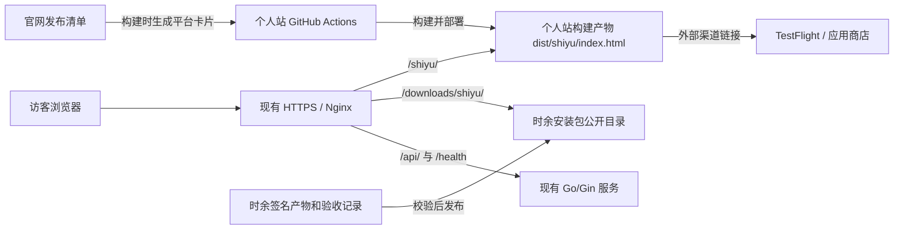

# 时余官网技术实施方案

- 版本 v0.1 · 2026-11-06 · 待评审
- 产品依据 [时余官网 PRD v1.1](官网设计.md)
- 实现范围为产品官网、平台下载入口和安装包托管。应用打包及对外分发继续按 [节点 14 发布验收](../../../docs/开发计划/14-签名打包与发布验收.md) 执行。

评审已确认采用个人站主域的 `/shiyu/`、从「构建」页进入，并保留独立安装包存储。新增的后台应用、安装包管理由 Xingverse 个人站仓库 `docs/需求文档/构建模块与时余官网迭代PRD-0.1.0.md` 接续。后续开发以该迭代 PRD 的后台发布状态和下载权限为准。本篇保留早期静态清单方案及其验证记录。

## 1. 推荐方案

**在 Xingverse 个人站的 React/Vite 构建中增加独立的 `/shiyu/` 静态页面，沿用现有 HTTPS 和前端发布流程。公开安装包走 Nginx 独立只读目录，官网用一份版本化清单展示下载、内测与商店入口。** 建议首版使用个人站主域名的 `/shiyu/`，省去新增子域名、证书和独立部署流程。Go/Gin、PostgreSQL 和媒体上传继续服务现有业务。



网页属于个人站仓库，PRD、素材原件和安装包验收属于时余仓库。发布时复制经审阅的网页素材，构建过程独立运行，不需要访问同级目录。安装包与网页分别上线。四个平台都在准备时，官网也可先作为产品介绍页。

## 2. 已有能力与复用边界

| 层级 | 仓库或环境 | 核对结果 | 本次处理 |
| --- | --- | --- | --- |
| 个人站 | `acsweets/xingverse` · `4b8c129` | React 19、Vite 8、React Router，已有中英文路径。作品页 `src/pages/Build.jsx` 目前是骨架 | 保留原 SPA，增加 Vite HTML 入口。作品页新增「时余」链接 |
| 网站部署 | 个人站 `.github/workflows/deploy.yml` | Node 22，`main` 构建 `dist/` 后以 `rsync --delete-delay` 同步；同一工作流同步 Nginx 配置并重启 | 官网纳入 `dist/`。包目录独立。上线前增加官网产物校验、配置校验和回查 |
| 公网网关 | 个人站 `deploy/nginx-default.conf` | 根站、`/api/`、`/health` 和公开媒体共用 Nginx，已有 HTTPS | 增加时余页面和包路径，保留既有路由、证书与 ACME 路径 |
| 后端 | `acsweets/xingverser-server` · `c25b5c4` | Go/Gin 提供账号、内容和媒体，生产 Compose 使用 PostgreSQL 16。媒体上传校验 `image` / `audio` 类型，Nginx 单独直出公开媒体 | 首版无需 Go 接口或数据库迁移。签名包从独立目录提供 |
| 时余构建 | `acsweets/shiyu` | 有四平台构建指引。仓库记录的 Android Release 当前用开发签名，Apple 发布与原生行为需按节点验收 | 用经授权的签名产物、真实商店或 TestFlight 链接激活平台状态 |

2026-11-06 做了公开只读验证。现有个人站主页及 `GET /health` 返回 200，`/shiyu/` 返回的 HTML 与个人站主页相同，符合当前 SPA 回退配置。另用现有 Node 22 和 Vite 8.2.2 在临时目录验证了个人站基线构建和最小双入口构建，两份 HTML 均生成，产品页可在构建时写入下载区。当前可用磁盘、出网带宽、容器实际挂载、生产凭据和时余签名包仍待上线前核对。

## 3. 前端落地

| 新增或修改 | 职责 |
| --- | --- |
| `shiyu/index.html` | 独立中文页面。直接写入首屏、功能、FAQ、隐私、安装与反馈说明，保留真正的标题和段落。以「桌面上有只猫，陪你看倒计时。」为主标题 |
| `src/features/shiyu/` | 页面专用样式、真实截图、首屏平台推荐组件和发布清单。独立于个人站的主题、登录态、Router 与资料 API |
| `vite.config.js` | 增加根 `index.html` 与 `shiyu/index.html` 两个 HTML 入口，保留已有分包与开发代理；全站 `base` 维持 `/` |
| `src/pages/Build.jsx` | 用普通链接跳转 `/shiyu/`，中英文作品页都可访问 |
| `deploy/nginx-default.conf` 与 `.github/workflows/deploy.yml` | 加入独立路径、构建校验、部署后验证和回滚记录 |

- 产物为 `dist/index.html` 和 `dist/shiyu/index.html`。开发与预览均直接访问 `/shiyu/`。个人站的语言路由不参与时余首页渲染，页面自带 `lang`、标题、canonical、OG 和 favicon。
- 用 Vite `transformIndexHtml` 在构建时读取并校验发布清单，生成四个平台的静态卡片。首屏先输出「查看各平台状态」作为通用链接，再由小型 React 组件使用同一份清单做平台推荐。即使 JavaScript 加载失败，页面内容、下载链接与 FAQ 仍可使用。
- 首屏只有在目标平台存在唯一明确的可用入口时直达；同平台有多个架构、平台未知或状态为准备中时，进入相应平台卡片或下载区。全部平台始终可手动选择，浏览器环境信息只在本页使用。
- 复用时余的橘猫图标和真实浮窗、小组件截图。截图只用示例数据。产品页与下载区使用同一份本地文案与素材，首版沿用 PRD 的简体中文范围。

Vite 多入口输出按 HTML 文件路径生成，现有根页面与 `/shiyu/` 可在同一次构建交付。[Vite 多页构建说明](https://vite.dev/guide/build.html#multi-page-app)

## 4. 发布清单

建议文件为个人站 `src/features/shiyu/releases.json`。仓库内的清单只保存面向访客公开的信息。平台卡片、首屏推荐和构建校验都从这里读取。

```json
{
  "schemaVersion": 1,
  "platforms": {
    "windows": [],
    "macos": [],
    "android": [],
    "ios": []
  }
}
```

| 渠道 | 字段与校验 | 页面状态 |
| --- | --- | --- |
| 空列表 | 保留平台，入口缺省 | 准备中 |
| `direct` | `releaseId`、`version`、`minOs`、`arch`、`path`、`bytes`、`sha256`、`installGuide`。路径限于 `/downloads/shiyu/<release-id>/<filename>`，版本目录必须与 `releaseId` 一致 | 可下载，显示真实版本、架构、大小和校验和 |
| `testflight` | 有效的公开 HTTPS 邀请链接、加入说明。校验 Apple 主机和邀请路径，开放前以外部测试者身份确认 | 公开内测 |
| `app-store` / `google-play` | 对应商店的 HTTPS 详情页、适用平台和安装说明。校验主机与应用标识 | 商店已上架 |

构建校验拒绝未知平台或渠道、重复架构入口、占位链接、越界路径、空版本、无效大小和 SHA-256。平台允许有多个真实渠道。已上线的商店链接和直链同时保留时，主入口使用清单指定的首选渠道，其他入口在卡片内展示。安装包字段从发布产物生成，商店状态由负责人核对。清单随前端部署生效，发生下架时同步收回首屏和卡片入口。

## 5. 服务器与安装包

### 路由和目录

| 路径 | 来源 | 行为 |
| --- | --- | --- |
| `/shiyu` | Nginx | 跳转 `/shiyu/`，保留查询参数 |
| `/shiyu/` | 现有网站静态卷 | 返回 `shiyu/index.html`；该前缀下缺失文件返回 404 |
| `/downloads/shiyu/<release-id>/<filename>` | 新增安装包公开卷 | Nginx 直接提供文件，支持 GET、HEAD 和 Range；目录不可列出 |

建议在网站同步目标和现有媒体目录以外，分配一个时余发布根目录。同一文件系统下分设 `staging/` 和 `public/`，Nginx 只读挂载 `public/` 到 `/srv/shiyu-releases/public/`。运维账号从受控 SSH 上传，应用容器和访客无需写权限。安装包保持原始签名、版本化路径和文件名，部署过程中校验大小和 SHA-256。

下列配置是增量草案，放入现有主域 HTTPS `server` 块，需用生产等价挂载验证后再启用。

```nginx
location = /shiyu {
    return 308 /shiyu/$is_args$args;
}

location ^~ /shiyu/ {
    root /usr/share/nginx/html;
    index index.html;
    try_files $uri $uri/ =404;
    add_header Cache-Control "no-cache";
}

location = /downloads/shiyu {
    return 404;
}

location = /downloads/shiyu/ {
    return 404;
}

location ^~ /downloads/shiyu/ {
    alias /srv/shiyu-releases/public/;
    autoindex off;
    disable_symlinks on;
    default_type application/octet-stream;
    limit_except GET { deny all; }
    add_header Content-Disposition "attachment";
    add_header X-Content-Type-Options "nosniff" always;
    add_header Cache-Control "public, max-age=3600";
}
```

发布前确认当前和上一可用版本、临时上传以及回滚副本所需空间，检查宿主机 `df -h`、`df -i` 与出口带宽。媒体逻辑配额与安装包容量分开计算。若服务器余量不足，可换成已确认的对象存储或 CDN，只替换下载来源并更新清单校验规则。现有 Xingverse 文档中的对象存储是迁移预案，实际可用桶与域名需另行确认。分发文件另留一份异机副本。[Nginx 路径映射与访问控制](https://nginx.org/en/docs/http/ngx_http_core_module.html#alias)

## 6. 实施和上线顺序

| 步骤 | 具体工作 | 进入下一步的条件 |
| --- | --- | --- |
| 1. 页面和清单 | 在个人站 `toly` 完成双入口、作品链接、发布清单和页面。先用空清单演示四平台准备状态 | `npm ci`、`npm run lint`、`npm run build` 通过，构建产物和桌面、移动预览通过 |
| 2. 预发验证 | 按实际容器挂载组装候选 Nginx 配置和只读下载卷。先校验候选配置，再用隔离目录的样本文件验证路径、Range、404 和禁止写入 | 候选配置 `nginx -t` 通过，现有首页、API、健康检查、公开媒体和 ACME 路由回归通过 |
| 3. 发布介绍页 | 确认目标域名、反馈入口、隐私说明和发布时机。由用户将个人站变更合入 `main`，触发现有网站部署 | `/shiyu/` 正常显示，个人站现有功能通过检查。无可用包的平台为准备中 |
| 4. 开放单个平台 | 时余完成该平台签名与安装验收；包先上传到 `staging/`，验明校验和后将版本目录整体移入 `public/`。商店或 TestFlight 直接核验外部入口 | 已授权的公开 URL 经普通网络验证，清单合入并发布后才出现按钮。各平台可分别开放 |

上线需要核对生产 Nginx 实际挂载及配置文件与前端仓库的差异，保留证书、ACME、静态站、API 网络和媒体挂载。首次新增挂载按维护窗口更新容器。现有工作流每次都同步配置，候选配置须进入个人站仓库；切换前用候选配置和等价挂载执行 `nginx -t`。

网站部署仍在同一个互斥工作流里执行。保留上一成功构建及其 Nginx 配置，先用不带删除选项的 `rsync` 同步资源，再替换两份入口 HTML。将旧资源清理从原来的整目录 `--delete-delay` 改为按版本执行，保留当前和上一可回滚版本引用的散列文件。任何一次部署都只操作网站目录。

**回滚分三类。** 平台入口错误时先回退发布清单；包本身需撤回时，同时撤下公开文件并复查直链及缓存，其他平台继续可用。官网页面异常时恢复上一份完整 `dist/`。网关配置异常时恢复上一份配置和挂载并验证。回滚后复查个人站首页、`GET /health`、API 和媒体。时余签名包与备份按节点 14 的记录管理。

## 7. 验收

| 检查点 | 通过条件 |
| --- | --- |
| 构建与内容 | 根首页与产品页均生成。查看产品页源 HTML 可读到主标题、FAQ 和平台状态。资源请求有正确类型，首屏和卡片从同一份清单生成 |
| 入口状态 | Windows、macOS、Android、iOS、未知平台、多架构与空清单均有正确落点。清单撤回渠道后，两处入口同时消失 |
| 下载 | 对每个开放的直链检查 HEAD、`Range: bytes=0-0` 得到 206、完整下载校验和匹配。缺失文件 404，目录不可枚举，公网无写入权限。商店链接与内测邀请由普通用户验证 |
| 兼容与安装 | 仅展示通过安装矩阵的系统与架构；在干净设备安装，已有版本可按发布计划升级并保留数据 |
| 现网回归 | 测试个人站首页、作品入口、`GET /health`、一个公开 API、一个公开媒体文件及既有登录页面；应用下载失败时仍可访问官网 |
| 撤回与恢复 | 实测回退清单或前端版本一次，并留存该版本的产物、配置校验和发布记录 |

## 8. 评审决策

1. **官网地址**。建议采用个人站主域的 `/shiyu/`，并从中英文作品页引流。
2. **安装包来源**。建议先用现有服务器的独立只读发布目录，以磁盘和出网实测为准。若已有正式对象存储，再按所选域名和访问策略替换下载来源。
3. **发布节奏与反馈**。建议先验收介绍页，已签名并获准分发的平台逐个开入口。上线前确认反馈渠道、隐私说明及首批开放平台。

## 源码与运维依据

- Xingverse 个人站 `4b8c129` 的 `package.json`、`vite.config.js`、`src/App.jsx`、`src/pages/Build.jsx`、`deploy/nginx-default.conf`、`.github/workflows/deploy.yml`。
- Xingverse 后端 `c25b5c4` 的 `go.mod`、`internal/http/router.go`、`internal/modules/media/service.go`、`deploy/docker-compose.production.yml`，及 `docs/当前实现/媒体存储全端实现与接口使用现状-0.0.1.md`、`docs/运维/域名解析与HTTPS接入操作手册-0.0.1.md`。仓库内 EchoLoop 的发布服务与强制更新文档标记为待实施。
- 时余 [官网设计](官网设计.md)、[构建说明](../../../README.md)、[应用发布验收](../../../docs/开发计划/14-签名打包与发布验收.md)。
