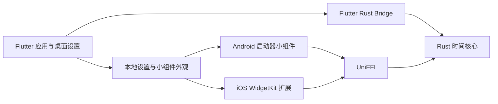

# 技术架构与验证

基线为 `ec09f09`。[项目记录](README.md) · [功能现状与设计基线](功能现状与设计基线.md)

## 运行分层

Flutter 与两个原生宿主调用同一套 Rust 业务规则。桌面子窗接收主窗口发送的可见文本和外观。手机原生小组件分别从私有目录或 App Group 加载配置，能在主应用未运行时读取数据。

| 层级 | 技术和职责 | 入口 |
| --- | --- | --- |
| UI 和状态 | Flutter 3.47.2、Dart 3.13.2、Material 3、Riverpod 容器与 ChangeNotifier 控制器。主窗口按可见状态启停前台刷新 | [Flutter 依赖](../../app/pubspec.yaml)、[退休控制器](../../app/lib/features/retirement/application/retirement_controller.dart) |
| 桌面宿主 | window_manager、desktop_multi_window、tray_manager 与 hotkey_manager 管理置顶、多窗、托盘和快捷键 | [窗口控制器](../../app/lib/platform/desktop/floating_window_controller.dart) |
| 计算 | Rust 1.95.0 workspace，jiff 固定时区数据库，serde JSON v1，rust_decimal 校验十进制输入 | [Rust workspace](../../core/Cargo.toml)、[核心依赖](../../core/crates/engine/Cargo.toml)、[数据契约](../技术说明/数据契约-v1.md) |
| 跨语言 | FRB 将 JSON 快照给 Flutter，UniFFI 将同一入口给 Kotlin 与 Swift。调用方传入绝对 UTC 毫秒与显式 IANA 时区 | [FRB 入口](../../core/crates/flutter_bridge/src/api/snapshot.rs)、[UniFFI 入口](../../core/crates/ffi/src/lib.rs) |
| Android | Kotlin、Gradle、AppWidgetProvider、RemoteViews，业务配置通过 AtomicFile 保存 | [Android 工程](../../app/android/app/build.gradle.kts)、[原生存储](../../app/android/app/src/main/kotlin/com/growthrecord/shiyu/widgets/WidgetSettings.kt) |
| Apple | Xcode、SwiftUI WidgetKit、App Group，扩展单独链接 Rust 静态库。Windows 与 Android 的通过结论独立于 Apple 实测 | [Apple 构建说明](../../native/ios/README.md)、[扩展构建脚本](../../scripts/build_widget_core.sh) |

## 数据与安全边界

- 退休日期、时区等业务字段写入版本化 `settings.json`。桌面布局、贴纸路径和移动组件外观单独保存。写业务配置前经 Rust 验证，损坏或未来版本保持只读。
- 无账号、遥测、后端服务或个人设置上传。退休切片不发网络请求。地区日历来源、许可、更新和离线策略归节点 06。
- `workspace/shiyu` 为独立仓库，Flutter 与 Rust 位于同仓库的 `app/` 和 `core/`。Apple 的签名和 App Group 能力需在发布主体的 Xcode 环境实测。

## 回归与排查

| 变更或现象 | 检查入口 |
| --- | --- |
| 日期、时区或边界错误 | 先核对固定 `now_millis`、IANA 时区和日历覆盖优先级，再跑 [Rust 契约测试](../../core/crates/engine/tests/contract_tests.rs) |
| 桌面拖动、置顶或窗口位置异常 | 检查 [窗口控制器](../../app/lib/platform/desktop/floating_window_controller.dart) 和 [桌面集成测试](../../app/integration_test/desktop_window_test.dart)，涉及桌面构建时运行 `scripts/check.ps1 -BuildWindows` |
| Flutter 与 Android 结果不同 | 使用相同设置与 now 运行 [退休集成测试](../../app/integration_test/retirement_test.dart)，比较 FRB 与 UniFFI 响应 |
| 小组件未更新 | 确认系统已添加、设置保存成功，再查 [WidgetBridge](../../app/lib/platform/widgets/widget_bridge.dart) 与原生接收、共享文件和系统更新机制 |
| iOS 组件无法出现 | 核对 App Group、Runner 与扩展签名和 Xcode 嵌入，按 [Apple 指南](../../native/ios/README.md)在 Mac 验证 |
| 常规格式、静态分析、单测及锁定依赖 | 使用 [仓库检查脚本](../../scripts/check.ps1)，CI 的 Windows 与 Android 检查见[工作流](../../.github/workflows/check.yml) |

## 基线规模

按 Git 跟踪的文本文件统计。排除构建产物、图片、依赖缓存、锁文件及名称或路径标识为生成的绑定与本地化文件。原生统计包括平台启动骨架。非空行包含注释，数字用于定位维护面。

| 类别 | 文件 | 物理行 | 非空行 |
| --- | ---: | ---: | ---: |
| Flutter 产品及探测入口 | 37 | 4820 | 4257 |
| Rust 核心、绑定入口和测试 | 13 | 690 | 650 |
| 原生平台代码 | 26 | 2420 | 2095 |
| 构建配置与工具脚本 | 75 | 3323 | 3078 |
| 本地化 ARB | 8 | 256 | 256 |
| Markdown 文档 | 64 | 10381 | 7850 |

工程的主要验证成本来自四套宿主生命周期、两条 Rust 绑定，以及相同设置和绝对时间在时区边界的行为一致性。
