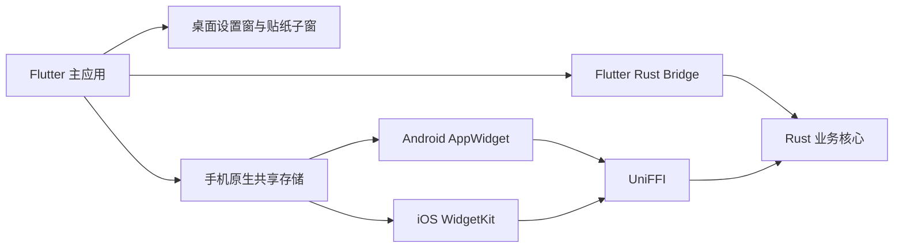

# 技术架构与验证

更新于 2026-11-06。基线为节点 12 提交 `f17de06` 与本地节点 13 工作树。

[项目记录](README.md) · [功能现状与设计基线](功能现状与设计基线.md) · [四平台运行](../../README.md#运行与构建)

## 运行分层

Flutter 主应用负责配置、状态和呈现。桌面子窗启动独立 Flutter 引擎，贴纸子窗接收当前分组的可见指标和外观，设置窗将操作交给主引擎。手机小组件通过各自的共享存储和 UniFFI 独立计算，主应用无需保持前台。

| 层 | 技术与职责 | 入口 |
| --- | --- | --- |
| Flutter 壳与状态 | Flutter 3.47.2、Dart 3.13.2、Material 3。Riverpod 注入运行时控制器，`ChangeNotifier` 驱动局部界面刷新。入口根据参数区分主应用、设置窗和贴纸子窗 | [启动](../../app/lib/main.dart)、[应用壳](../../app/lib/app/runtime_shiyu_app.dart)、[控制器](../../app/lib/features/retirement/application/retirement_controller.dart) |
| 业务计算 | Rust 1.95.0，serde 负责版本化 JSON，jiff 负责 IANA 时区和日历，rust_decimal 与整数比例处理薪资。核心集中实现设置校验、快照、时间线和自定义倒计时变更 | [Rust workspace](../../core/Cargo.toml)、[核心依赖](../../core/crates/engine/Cargo.toml)、[快照](../../core/crates/engine/src/snapshot.rs)、[时间线](../../core/crates/engine/src/timeline.rs) |
| Flutter ↔ Rust | Flutter Rust Bridge 2.12.0。Dart 网关传入配置、绝对时间戳和可选地区日历，消费核心返回的 JSON | [Dart 网关](../../app/lib/features/retirement/domain/core_gateway.dart)、[Rust 桥接入口](../../core/crates/flutter_bridge/src/api/snapshot.rs) |
| 小组件 ↔ Rust | UniFFI 0.32.2。Android 通过 Kotlin 和 JNA，iOS 通过 Swift 和原生静态库。两端沿用核心设置、快照和错误契约 | [UniFFI 导出](../../core/crates/ffi/src/lib.rs)、[Android 输入](../../app/android/app/src/main/kotlin/com/growthrecord/shiyu/widgets/WidgetInputs.kt)、[Apple 模型](../../app/ios/ShiyuWidgets/WidgetModels.swift) |
| Windows 桌面 | C++ Win32 宿主处理单实例、运行时消息、快捷键、全屏检测、启动项和物理坐标。Dart 用 window_manager、desktop_multi_window、tray_manager、screen_retriever 组织窗口和托盘 | [窗口宿主](../../app/windows/runner/flutter_window.cpp)、[单实例与系统行为](../../app/windows/runner/desktop_session.cpp)、[位置通道](../../app/windows/runner/desktop_geometry.cpp) |
| macOS 桌面 | AppKit 与 Flutter 桌面宿主，调用窗口空间能力及登录项。macOS 13+ 使用 `SMAppService`，快捷键使用 hotkey_manager | [窗口宿主](../../app/macos/Runner/MainFlutterWindow.swift)、[桌面控制器](../../app/lib/platform/desktop/floating_window_controller.dart) |
| Android 组件 | Kotlin、AppWidgetProvider、RemoteViews、Chronometer、AlarmManager。宽窄布局由尺寸决定，组件实例的指标选择由原生侧保存 | [组件提供者](../../app/android/app/src/main/kotlin/com/growthrecord/shiyu/widgets/RetirementWidget.kt)、[实例选择](../../app/android/app/src/main/kotlin/com/growthrecord/shiyu/widgets/WidgetSelection.kt)、[刷新调度](../../app/android/app/src/main/kotlin/com/growthrecord/shiyu/widgets/WidgetUpdates.kt) |
| iOS 组件 | SwiftUI、WidgetKit、App Intents。Runner 嵌入 `ShiyuWidgets.appex`，扩展的构建阶段按 SDK 和 CPU 架构编译 `shiyu_ffi` | [时间线和组件注册](../../app/ios/ShiyuWidgets/RetirementWidget.swift)、[Xcode 工程](../../app/ios/Runner.xcodeproj/project.pbxproj)、[Rust 静态库脚本](../../scripts/build_widget_core.sh) |

## 从设置到界面

1. 用户在桌面完整设置或移动分类表单修改配置。编辑器提交整个候选设置，仓库交给 Rust 校验。保存先检查主文件是否被其他写入改变，再备份旧配置并原子替换。
2. 应用按新的配置和当前时钟计算快照。Rust 用 UTC 毫秒作为输入，并以配置中的 IANA 时区解释日历和工作时段。Flutter 按语言格式化完整倒计时和金额；Windows、macOS 和移动首页使用同一指标映射。
3. 桌面窗口根据分组选择指标。主引擎给贴纸子窗发送可见文本、标题显隐、外观和几何信息。原生拖动、缩放与 Flutter 状态异步交互，布局恢复使用版本检查，避免过时的位置写回覆盖新操作。
4. 移动端通过 `shiyu/widgets` 保存原生配置并请求组件刷新。Android 更新 RemoteViews，iOS 调用 WidgetKit 请求重建时间线；组件侧从原生存储读取最新输入并独立调用 Rust。

[编辑器](../../app/lib/features/retirement/application/settings_editor.dart) · [配置仓库](../../app/lib/features/retirement/data/settings_repository.dart) · [分组数据](../../app/lib/features/desktop_stickers/application/sticker_group_view.dart) · [WidgetBridge](../../app/lib/platform/widgets/widget_bridge.dart) · [数据契约 v1](../技术说明/数据契约-v1.md)

### 三种刷新节奏

| 环境 | 怎么刷新 | 为什么需要单独验证 |
| --- | --- | --- |
| Flutter 前台 | 有活动计时时对齐下一整秒；低频状态最多等待约一分钟，并提前响应核心给出的下次状态变化。重新保存活动目标会回到整秒节奏 | 全局隐藏、关闭所有有数据的浮窗、暂停或挂起会停止刷新。显示或唤醒后按当前时间重新计算 |
| Android 主屏幕 | 两类组件共享一次原生快照；Chronometer 在启动器本地走秒。非唤醒闹钟根据下次变化请求重算，含薪资时以约一分钟为上限，否则约十五分钟 | 省电和启动器会延迟到期切换。设置保存和主应用重新启动会主动请求刷新 |
| iOS 主屏幕 | 时间线根据下次边界和刷新窗口安排快照。iOS 16+ 的活动倒计时由 SwiftUI 系统计时文本显示，薪资使用当前样本 | WidgetKit 决定实际重载时机，配置写入及时间线交接须在目标系统验证 |

## 文件、隐私和网络

| 数据 | 保存位置与规则 |
| --- | --- |
| 应用设置 | 版本化 `settings.json`，上限 128 KiB。桌面使用应用支持目录下的 `shiyu/`，Android 使用应用私有文件，iOS 主配置在 `group.com.growthrecord.shiyu`。已知旧版经校验迁移，损坏配置可进入只读回退，未来版本保护原文件 |
| 恢复副本 | Flutter 仓库保留合法旧副本，Android 恢复文件名与 AtomicFile 的 `.bak` 区分。显式恢复前留存损坏原件。Android 和 iOS 的组件侧还维护 `settings.last-good.json`，回退副本时强制遮蔽金额 |
| 桌面外观 | 布局、槽位、几何尺寸、屏幕锚点和色板写入 `shiyu/appearance/layout.json`。角色文件和资源包与业务配置分离，导入时校验清单、路径、PNG 和大小 |
| 移动外观 | Android 私有文件或 iOS App Group 中的 `widget_appearance.json`，由原生组件读取。标题逐项偏好仍在业务配置内 |
| 假日 | 打包六地区 2026–2027 数据。Flutter 从内置、下载缓存及区域导入中选有效新版本，并同步已校验的数据给组件。计算优先级为个人日期覆盖 → 自定义假期 → 地区日期覆盖 → 每周工作日 |
| 网络 | 当前业务网络入口是公开假日目录的 HTTPS GET。请求固定读取完整目录，关闭自动重定向，无配置或薪资上传。运行形态没有账号、后台服务、入站端口或遥测 |

金额遮蔽作用于快照和展示，设置文件仍保存用户配置的薪资。导出 JSON 前应按本地敏感文件处理。快捷键的临时金额显示与共享配置分离。查看存储实现时优先从[文件适配器](../../app/lib/features/retirement/data/settings_store.dart)、[Android 私有存储](../../app/android/app/src/main/kotlin/com/growthrecord/shiyu/widgets/WidgetSettings.kt)、[Apple 共享存储](../../app/ios/Shared/SharedWidgetStore.swift)与[假日下载](../../app/lib/features/retirement/data/holiday_download.dart)进入。

## 构建与验证

- Flutter 包位于 `app/`。Cargokit 通过 `app/rust_builder/` 适配各宿主的 Rust 编译和链接，保留项目自己的工具链与 Gradle 补丁。生成绑定通常直接使用仓库版本，改桥接接口后再生成。iOS 扩展使用独立的 Xcode 构建阶段。[Cargokit 补丁](../../app/rust_builder/SHIYU_PATCHES.md) · [绑定脚本](../../scripts/generate_bindings.ps1)
- Windows 使用 CMake 和 MSVC，Android 使用 Gradle Wrapper 9.3.1、AGP 9.1.0、CI 基线 JDK 21、SDK 36 和 NDK 28.2.13676358。Apple 使用 Xcode 和 Flutter 原生依赖集成，开发签名、扩展嵌入及 App Group 需要在 Mac 核对。[工作流](../../.github/workflows/check.yml) · [Apple 指南](../../native/ios/README.md)
- 仓库检查包含锁定依赖、生成本地化、格式、静态分析、Flutter 测试和 Rust fmt、clippy、测试。CI 配置执行 Windows Release 和 Android x86_64 Debug 包验证。Apple 使用单独的检查脚本，原生效果仍需要真机或模拟器验收。[通用检查](../../scripts/check.ps1) · [Apple 检查](../../scripts/check_apple.sh)
- 已有 Windows Release 和 Android API 36 x86_64 的回归证据。内存与冷启动目标仍需固定设备复测，长期运行和 Apple 当前版本实测待补。正式签名、商店包和升级回滚属于节点 14。[节点 13 验收](../验收记录/13/README.md) · [发布节点](../开发计划/14-签名打包与发布验收.md)

| 现象或改动 | 先检查 | 最小验证 |
| --- | --- | --- |
| 日期偏一天、假期不对、金额与预期不同 | 固定 `now_millis`、时区、日期覆盖优先级和工作时段；用核心 JSON 响应区分计算与显示 | Rust 契约与时间指标测试；涉及金额时加薪资时间线集成。[核心测试](../../core/crates/engine/tests) |
| 主窗看不到、拉伸或布局异常 | 托盘显隐与穿透、已启动实例的路径、主槽位、原生初始绘制尺寸和恢复后 DPI。Windows 的旧实例会接收新版启动请求 | 真实 Release 中带旧布局冷启动并查看画面，再跑桌面原生集成。[Windows 行为测试](../../app/integration_test/desktop_window_test.dart) |
| 标题、语言或配色不一致 | 检查 ARB、逐项标题与整窗/整组件开关、主引擎下发的分组数据，以及 Android/iOS 独立资源 | Flutter 单测与 Windows 预览；小组件改动要在启动器或 WidgetKit 验证。[Flutter 测试](../../app/test) |
| 设置不能保存、升级后被恢复 | 查 Rust 校验结果、旧版迁移及主文件并发检查；Android 检查原文写入、AtomicFile 备份命名与 R8/JNA 规则 | Flutter 设置恢复测试和 Android Release 连续两次保存。[Android 保留规则](../../app/android/app/proguard-rules.pro) |
| 小组件停住、无法添加或一直显示未配置 | 先确认应用已保存和系统已添加。再查原生桥、启动器或 WidgetKit 调度；iOS 检查 Team、App Group 和扩展嵌入 | 保存一次并退到后台，验证计时递减、到期、标题和金额遮蔽。[小组件验收](../验收记录/12/README.md) |
| 接口或生成绑定变化 | 同时复核 FRB 和 UniFFI 导出、两边的 JSON schema、Kotlin/Swift 生成物和对应 CPU 架构 | Rust 测试、Flutter 真实桥接、Android APK 与 Swift 主机探测。[桥接集成](../../app/integration_test/bridge_test.dart) |
| Android 构建卡在依赖下载或找不到工具 | 区分 SDK/NDK、Java、仓库代理和 ABI；直调 Gradle 时 Cargokit 依赖 `FLUTTER_ROOT`。先使用 README 的 Flutter 构建入口 | 构建指定 ABI 的 APK，检查 Rust 库并在匹配设备安装。[APK 检查脚本](../../scripts/verify_android_package.py) |

## 代码规模

以本次写作前的 Git 跟踪文件和未忽略的新文件为样本，排除构建产物、缓存、二进制、锁文件、生成绑定、生成本地化和 Cargokit 第三方构建源码。物理行含空行，非空行含注释。Flutter 源码含运行时探测入口，原生源码含平台宿主与 Swift 主机探测，工程配置含原生布局 XML 和脚本。

| 类别 | 文件 | 物理行 | 非空行 |
| --- | ---: | ---: | ---: |
| Flutter 应用源码 | 80 | 11,490 | 10,341 |
| Flutter 测试与验证工具 | 20 | 2,356 | 2,209 |
| Rust 业务与桥接入口 | 24 | 1,945 | 1,820 |
| Rust 测试与基准 | 4 | 606 | 568 |
| 原生宿主、组件和探测 | 37 | 2,842 | 2,503 |
| 工程配置与构建脚本 | 85 | 4,029 | 3,771 |
| 本地化 ARB | 8 | 1,337 | 1,337 |
| Markdown | 78 | 10,946 | 8,256 |

仓库保留一份 Cargokit 模板与局部补丁。业务代码规模主要集中在 Flutter，验证复杂度主要来自四套系统宿主、两条 Rust 绑定和独立于前台运行的系统小组件。调整计算规则时用相同配置、绝对时间与地区日历在各调用侧对照；调整窗口或小组件时补充真实系统画面和生命周期证据。
